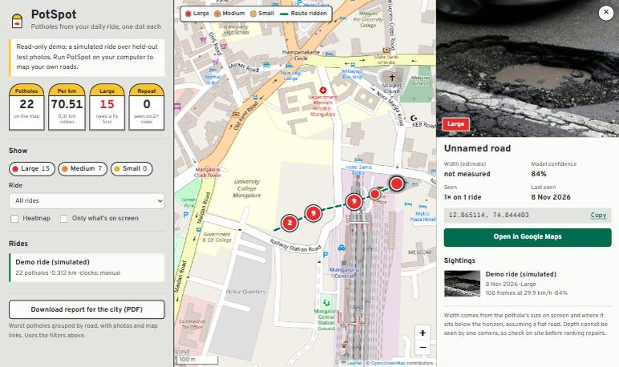
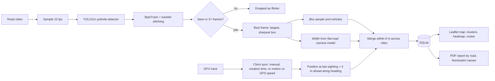
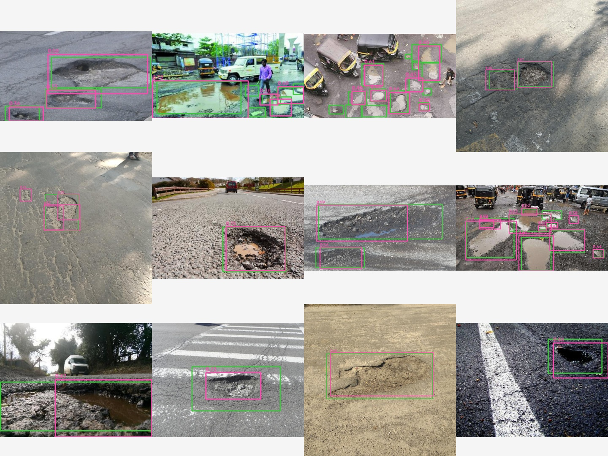
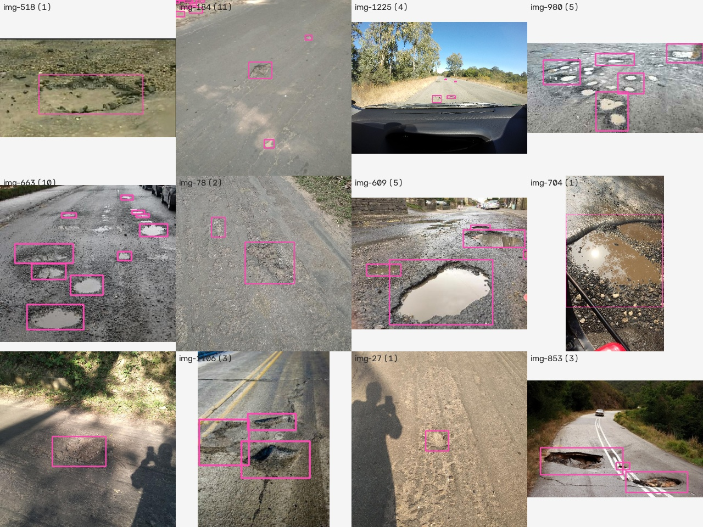

# PotSpot

**Record your commute with a phone, get back a map of every pothole on it, sized, deduplicated and ready to send to the city.**

PotSpot is the "RoadScan" project: a computer-vision pipeline that finds potholes in dashcam video with a fine-tuned YOLO11 model, follows each one across frames so it is counted once, places it on the road using the GPS track from the same ride, and merges repeat sightings across rides. The result is a Leaflet map and a PDF report grouped by road.

[Live read-only demo](https://siddharthbhat120.github.io/POTSPOT/) · [Demo script and interview notes](docs/DEMO_AND_INTERVIEW.md)



## Why

City corporations learn about potholes one complaint at a time, so nobody has a full, current map. A phone on a handlebar already sees every pothole on the daily ride. PotSpot turns that footage into one dot per pothole, with a photo, a size class and a Google Maps link, and keeps the map current as more rides come in.

## How it works



1. **Detect.** A YOLO11n model fine-tuned on 1,211 training images (932 photos plus rain, motion-blur and dusk variants) runs on every sampled frame.
2. **Track.** ByteTrack links boxes across frames. When it loses a pothole that jumps near the bottom of the frame, a stitching step joins the next track if it starts within 0.6 s near the predicted position and is at least as large. A pothole must be seen in 3 frames to count, which removes one-frame flickers.
3. **Place.** The GPX track is interpolated at the moment of the last sighting (when the pothole is closest), then moved 4 m ahead along the heading, because the camera sees the road in front of the bike.
4. **Size.** Width ≈ camera height × box width ÷ (box bottom − horizon), from a pinhole camera over a flat road. Below 0.30 m is small, above 0.70 m is large. Boxes cut off by the frame edge are skipped and the median over all sightings is used.
5. **Merge.** A sighting within 8 m of a pothole found on another ride becomes another sighting of it, so the map shows "seen 3× on 2 rides" instead of three dots.
6. **Report.** The PDF for the current filters has summary numbers, a map, and the worst potholes grouped by road with photo, coordinates and a maps link.

## Results

### Detector, on 155 held-out test photos

| Metric | Value |
|---|---|
| mAP50 | **0.621** |
| mAP50-95 | 0.314 |
| Precision / recall (Ultralytics, best F1 point) | 0.719 / 0.535 |
| At the app's working confidence 0.25: found / missed / false alarms | 286 / 212 / 114 of 498 labelled potholes |
| Model | YOLO11n, 2.6 M parameters, 512 px, 35 epochs on CPU (val mAP50 0.655), 47 ms per image on CPU |

Full numbers: [docs/eval/metrics.json](docs/eval/metrics.json). Training curves: `runs/` after you train.

What the numbers mean here: **precision** is how many of the potholes it reports are real; **recall** is how many of the real potholes it finds; **mAP50** is the area under the precision-recall curve when a box counts as correct if it overlaps the hand-drawn box by half. For a city survey recall matters more: a missed pothole stays dangerous, while a false one costs an inspector a minute, and the 3-frame rule plus repeat rides filter false ones further.

Recall depends heavily on size, which on a ride means distance: the model finds most potholes once they are close.

| Pothole size in the photo | Labelled | Found | Recall |
|---|---|---|---|
| Large (over 10% of the image) | 93 | 80 | 0.86 |
| Medium (1 to 10%) | 252 | 156 | 0.62 |
| Small (under 1%, far away) | 153 | 50 | 0.33 |

On video this matters less than the photo numbers suggest: a far pothole that is missed at 30 m usually becomes a medium or large one a second later, and the tracker only needs it in 3 frames.

**Where it fails.** I looked at the 16 worst misses and 16 most confident false alarms ([missed](docs/eval/failures_missed.jpg), [false alarms](docs/eval/failures_false.jpg)):

- **Water-filled potholes that reflect the sky or buildings** are missed: the model sees a bright, smooth patch, not a hole.
- **Shallow, worn patches and potholes under a shadow** have little contrast and are missed or found at low confidence.
- **Far potholes near the horizon** are a few pixels high (the small row above).
- **Tar seal lines, skid marks and sandy patches** are the real false alarms: dark or rough shapes on smooth asphalt.
- **Box disagreements** explain many of the rest: where a label draws one box around a cluster of potholes, the model often draws three, and the reverse. Each counts as a miss plus a false alarm even though the pothole was found. I saw no manhole covers in the test set, so I cannot say how it handles them.

Fixes, in order of value: hard-negative images (seal lines, patches, manholes, shadows) labelled as background, more wet and night images such as RDD2022 (`ml/data/rdd2022.py` adds them), and a larger model at 640 px on a GPU (`notebooks/train.ipynb`).



### Tracking, on the demo ride

The demo ride is a 42 s, 30 fps clip made from 12 held-out test photos, zooming in to imitate riding towards each pothole. Because each photo has hand-drawn boxes, the number of distinct potholes is known (35), so tracking can be scored. `python -m ml.track_eval` reproduces this.

| | |
|---|---|
| Frames analysed (15 fps) | 630 |
| Raw detections | **1,238** |
| Tracks after ByteTrack / after stitching | 29 / 22 (5 broken tracks joined) |
| Pothole records on the map | **22** |
| Labelled potholes found | 19 of 35 (recall 0.54, same as on photos) |
| Same pothole counted twice | **0** |
| Records that match no label | 3 |
| Processing time | 41 s for 42 s of video on CPU |

Without tracking the map would have 1,238 dots for 35 potholes. With it, every pothole found is one record.

### Dataset

[IVCNZ 2020 pothole dataset](https://github.com/jaygala24/pothole-detection) (MIT licence), 1,243 dashcam and phone photos with 4,075 pothole boxes. One box outside the image was dropped. **714 photos (57%) have a near-identical twin** (same scene, a frame apart or re-encoded); a random split would put twins on both sides and inflate test scores. `ml/data/prepare.py` groups them with a perceptual hash and keeps each group in one split (932 / 156 / 155 photos).



## Quick start (Windows)

You need Python 3.10 to 3.13 ([python.org](https://www.python.org/downloads/), tick "Add python.exe to PATH") and ffmpeg is optional (for H.264 annotated videos; without it they are saved as MPEG-4).

1. Extract the zip and open the folder in VS Code.
2. Double-click `run.bat`, or in the VS Code terminal run `.\run.bat`.
3. The first run installs PyTorch (CPU, about 250 MB) and takes a few minutes. Your browser opens at http://127.0.0.1:8002.
4. Click **Run the demo ride** to see a full ride processed, or **Add a ride** to upload your own video and GPX file.

macOS or Linux: `./run.sh`. Docker: `docker compose up` and open http://localhost:8002.

### Recording your own ride

- Mount the phone facing forward, low and level (a handlebar or dashboard mount), with the road filling the lower half of the frame. Never handle the phone while riding.
- Start a GPS logger app that exports GPX (for example GPSLogger on Android or Open GPX Tracker on iPhone), then start the camera.
- In **Add a ride**, keep "Automatic" clock sync: PotSpot matches how fast the road moves in the video to the GPS speed. If you know the gap (camera started 4 s after the logger), choose "I know it".
- If you change the mount height, set `CAMERA_HEIGHT_M` in `.env` so sizes stay right.

### Developer commands

```bash
python -m pytest backend/tests -q          # 22 tests, no model or internet needed
python -m ml.pipeline demo/demo_trip.mp4 --gpx demo/demo_trip.gpx --out runs/demo
python -m ml.data.download && python -m ml.data.prepare && python -m ml.data.augment_road
python -m ml.train                         # CPU, about 3.5 hours; notebooks/train.ipynb does it on a free Colab GPU
python -m ml.evaluate && python -m ml.track_eval
cd frontend && npm install && npm run dev  # UI on :5175, API proxied to :8002
python scripts/export_snapshot.py --out site   # static read-only demo for GitHub Pages
```

## Privacy

Every saved photo is a crop of the best frame, and people, cars, motorbikes, buses and trucks in it are blurred by a COCO-trained YOLO11n (`ml/privacy.py`), which covers faces and number plates. The pothole's own box is kept sharp. Uploaded videos and GPX files stay on your computer and are never served by the API; only the blurred crops and the annotated video are.

## Limitations

- **Night and rain.** The training photos are daytime. Rain and dusk variants help, but at night or with water filling a pothole, recall drops. Wet patches and dark shadows are among the false positives.
- **Shadows and patches.** Tree shadows, fresh tar patches and manhole covers look like potholes at a glance. See the failure images above.
- **Size is an estimate, not a measurement.** It assumes a flat road, a known mount height and horizon. Slopes, bumps and a tilted phone move the horizon and the estimate with it. Depth cannot be seen by one camera. Treat small / medium / large as a ranking hint and check on site.
- **GPS drift.** Phone GPS is good to 3 to 10 m. Under trees or between tall buildings it can wander onto a parallel road, and the 8 m merge radius can join two close potholes or split one.
- **Clock drift.** The sync finds one offset for the whole ride. If the phone's video clock drifts over a long ride, positions slowly slide; splitting long rides into 10 to 15 minute clips keeps this small.
- **The demo ride is simulated.** It is made from held-out test photos with a zoom to fake approaching each pothole, on a simulated GPX track near Mangaluru that does not follow a real road, so dots can sit off the street on the map. Web photos were taken with many cameras and the zoom breaks the flat-road size model, so the demo shows no widths and ranks potholes by how much of the frame they cover. Real-road numbers need your own rides.

## Stack

Python, Ultralytics YOLO11, ByteTrack, OpenCV, FastAPI, SQLAlchemy 2 + SQLite, ReportLab, React 19 + Vite, Leaflet with markercluster and leaflet.heat, OpenStreetMap and Nominatim. Tested with pytest on GitHub Actions.

## Licence

Code: MIT. Dataset: pothole dataset by Chitale et al. (IVCNZ 2020), hosted by jaygala24/pothole-detection (MIT). Map data © OpenStreetMap contributors.
